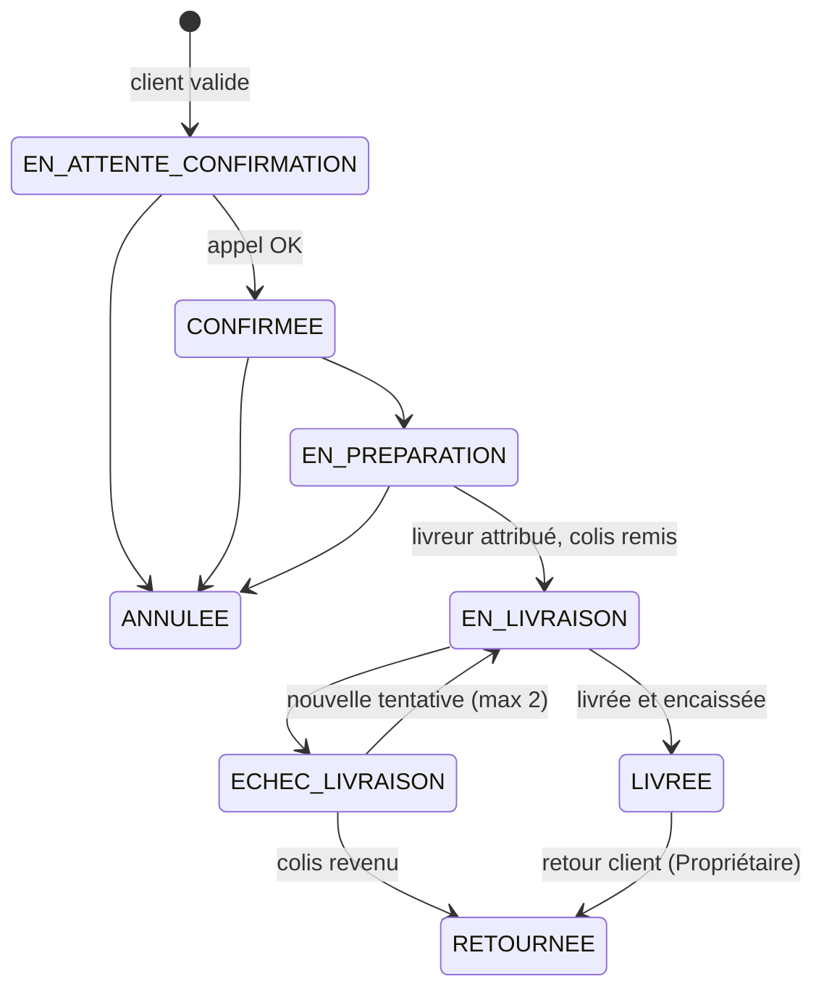

# Conception fonctionnelle — « Projet Parfums » (MVP)

Version 1 — 2026-10-26 — statut : **proposée, en attente de validation**.

Base : cadrage validé le 2026-10-26 (voir [`SUIVI.md`](../SUIVI.md)). Les éléments marqués **[À CONFIRMER]** sont des propositions qui attendent une décision du porteur du projet.

---

## 1. Rappel du cadre

- Boutique en ligne d'une **marque unique** de parfums (la marque du porteur).
- Marché : Côte d'Ivoire, **Abidjan** au lancement. Langue : français. Devise : XOF (montants entiers, pas de décimales).
- Paiement au lancement : **paiement à la livraison uniquement**, en espèces au livreur.
- Livraison par **livreurs internes**, tarif par commune.
- Commande **avec ou sans compte** ; numéro de téléphone obligatoire.

Évolutions après le MVP : **mobile money** (étape 11, §11), prêt mais désactivé tant que le prestataire n'est pas choisi ; **codes promo** (étape 13, §12).

Hors MVP (prévu dans le modèle, pas développé) : carte bancaire, avis, favoris, bannières administrables, newsletter, paniers abandonnés, permissions granulaires, multi-pays, prix barrés.

---

## 2. Acteurs

| Acteur | Description |
|---|---|
| **Visiteur** | Navigue sans être connecté. Peut commander en invité. |
| **Client** | Possède un compte (e-mail + mot de passe). |
| **Livreur** | Collaborateur qui livre et encaisse. Accès limité à ses livraisons, depuis son téléphone. |
| **Gestionnaire** | Collaborateur qui traite les commandes, le catalogue et le stock. |
| **Propriétaire** | Accès complet, y compris paramètres, collaborateurs et journal d'audit. |

---

## 3. Fonctionnalités du MVP

### 3.1 Boutique publique
- **F-01** Accueil : visuel principal, nouveautés, meilleures ventes, collections.
- **F-02** Catalogue : liste des parfums publiés, pagination.
- **F-03** Collections : navigation par collection (remplace « par marques », marque unique).
- **F-04** Recherche par nom de parfum ou note olfactive.
- **F-05** Filtres : genre (femme / homme / mixte), famille olfactive, prix, contenance, disponibilité.
- **F-06** Tri : prix croissant / décroissant, nouveautés, popularité (nombre d'unités vendues).
- **F-07** Fiche produit : galerie d'images, description, pyramide olfactive (notes de tête / cœur / fond), choix de la contenance (30 / 50 / 100 ml…), prix par contenance, disponibilité, produits similaires (même famille olfactive).
- **F-08** Panier : ajout, modification de quantité, suppression, total, frais de livraison estimés.
- **F-09** Commande : coordonnées, adresse, commune, récapitulatif, acceptation des CGV, validation.
- **F-10** Confirmation de commande avec numéro de commande.
- **F-11** Suivi de commande : par compte, ou en invité avec numéro de commande + téléphone.
- **F-12** Pages : contact (formulaire + lien WhatsApp), FAQ, CGV, politique de confidentialité, livraison, retours, mentions légales.

### 3.2 Espace client
- **F-20** Inscription, connexion, déconnexion.
- **F-21** Mot de passe oublié (lien par e-mail).
- **F-22** Profil : nom, téléphone, e-mail, changement de mot de passe.
- **F-23** Carnet d'adresses (plusieurs adresses, une par défaut).
- **F-24** Historique et détail des commandes, avec suivi.
- **F-25** Annulation d'une commande tant qu'elle n'est pas partie en livraison.
- **F-26** Rattachement des commandes passées en invité au compte : proposé **hors MVP** **[À CONFIRMER — voir §10, point 5]**.

### 3.3 Back-office
- **F-40** Tableau de bord : chiffre d'affaires encaissé, nombre de commandes, panier moyen, commandes à traiter, meilleures ventes, ruptures et stocks faibles, taux de livraisons réussies, filtre par période.
- **F-41** Catalogue : collections, familles olfactives, produits, variantes (contenance, SKU unique, prix de vente, prix d'achat facultatif), images, publication / dépublication / archivage.
- **F-42** Stock : entrées, ajustements (avec motif), historique des mouvements, seuil d'alerte par variante.
- **F-43** Commandes : liste filtrable (statut, date, commune, livreur), recherche par numéro / nom / téléphone, détail, changement de statut contrôlé, confirmation téléphonique, attribution d'un livreur, annulation, bon de préparation et bordereau de livraison imprimables, historique des actions.
- **F-44** Encaissements : montants encaissés par livreur, remise de caisse, écarts.
- **F-45** Clients : liste, fiche, historique des commandes.
- **F-46** Messages de contact reçus (lecture, marqué traité).
- **F-47** Paramètres (Propriétaire) : communes desservies, frais et délais par commune, informations de la boutique.
- **F-48** Collaborateurs (Propriétaire) : création, rôle, désactivation.
- **F-49** Journal d'audit (Propriétaire).

### 3.4 Espace livreur (mobile)
- **F-60** Liste de mes livraisons du jour : client, téléphone (appel en un clic), adresse, montant à encaisser.
- **F-61** Marquer « livrée et encaissée » ou « échec » avec motif.

### 3.5 Notifications (MVP)
- E-mail au client (si e-mail fourni) : commande reçue, commande confirmée, partie en livraison, livrée, annulée.
- E-mail à la boutique : nouvelle commande, nouveau message de contact, stock sous le seuil.
- SMS et WhatsApp automatiques : **hors MVP** (coût par envoi). La confirmation téléphonique humaine couvre les clients sans e-mail.

---

## 4. Parcours utilisateurs

### P1 — Achat en invité (parcours principal)
1. Le visiteur arrive sur l'accueil (souvent depuis les réseaux sociaux, sur mobile).
2. Il ouvre une collection ou cherche un parfum, filtre, ouvre une fiche produit.
3. Il choisit une contenance, ajoute au panier.
4. Dans le panier, il ajuste les quantités, clique « Commander ».
5. Il choisit « Continuer sans compte », saisit nom, téléphone, e-mail (facultatif), commune, adresse et indications (repères).
6. Il voit le récapitulatif : articles, frais de livraison de sa commune, délai indicatif, total à payer **en espèces à la livraison**.
7. Il accepte les CGV et valide. Le stock est réservé.
8. Page de confirmation : numéro de commande, message « Nous vous appellerons pour confirmer ».
9. La boutique l'appelle, confirme ; la commande est préparée puis livrée ; il paie le livreur.

### P2 — Achat avec compte
Identique à P1, mais les coordonnées et adresses sont pré-remplies ; la commande apparaît dans l'espace client. Le panier se retrouve après connexion (fusion avec le panier du visiteur).

### P3 — Suivi de commande
- Client : Espace client → Mes commandes → détail.
- Invité : page « Suivre ma commande » → numéro de commande + téléphone → statut et historique.

### P4 — Traitement d'une commande (Gestionnaire)
1. Nouvelle commande « En attente de confirmation » dans la liste (et e-mail à la boutique).
2. Il appelle le client : confirmé → « Confirmée » ; injoignable → tentative notée ; annulation demandée → « Annulée » (stock libéré).
3. Il prépare le colis, imprime le bon de préparation → « En préparation ».
4. Il attribue un livreur, imprime le bordereau, remet le colis → « En livraison » (le stock sort physiquement).
5. Le livreur clôture : « Livrée » (encaissée) ou « Échec de livraison ».

### P5 — Livraison (Livreur)
1. Le livreur ouvre sa liste du jour sur son téléphone.
2. Il appelle le client en un clic, livre, encaisse le montant exact affiché.
3. Il marque « Livrée et encaissée », ou « Échec » avec motif (injoignable, refus, adresse introuvable, reportée).

### P6 — Remise de caisse
1. En fin de tournée, le livreur remet les espèces.
2. Le Gestionnaire voit le total attendu (somme des commandes encaissées non remises), saisit le montant reçu.
3. Les commandes passent à « Remis en caisse ». Tout écart est enregistré et visible du Propriétaire.

### P7 — Ajout d'un parfum (Propriétaire ou Gestionnaire)
1. Créer le produit : nom, collection, genre, famille olfactive, notes, description.
2. Ajouter les variantes : contenance, SKU, prix, stock initial (mouvement « Entrée »), seuil d'alerte.
3. Ajouter les images, définir l'image principale.
4. Publier (refusé si les conditions de RG-03 ne sont pas remplies).

---

## 5. Règles métier

### Catalogue
- **RG-01** Tous les montants sont des **entiers en XOF**. Les prix affichés sont **TTC**. **[À CONFIRMER : régime de TVA de l'entreprise, avec ton comptable]**
- **RG-02** Chaque variante a un **SKU unique** et un prix strictement positif.
- **RG-03** Un produit ne peut être publié que s'il a au moins une variante active avec un prix et au moins une image.
- **RG-04** Un produit **archivé** disparaît de la boutique mais reste visible dans les commandes passées. Un produit qui a déjà été commandé ne peut pas être supprimé, seulement archivé.
- **RG-05** L'URL d'un produit est lisible et stable : `/parfums/<nom-du-parfum>`.

### Stock
- **RG-10** Pour chaque variante : **stock physique**, **stock réservé**, **stock disponible = physique − réservé**.
- **RG-11** Toute modification de stock crée un **mouvement** horodaté (type, quantité, auteur, motif, commande liée). Le stock n'est jamais modifié sans mouvement.
- **RG-12** À la validation d'une commande, les quantités sont **réservées de façon atomique**. Si une seule ligne n'a pas assez de stock disponible, la commande est refusée en entier et le client voit quelles lignes posent problème.
- **RG-13** Au passage « En livraison », le stock physique et le stock réservé diminuent (mouvement « Sortie vente »).
- **RG-14** Annulation avant livraison : la réservation est libérée.
- **RG-15** Colis revenu (échec définitif ou retour) : le stock physique n'est réintégré qu'après contrôle par le Gestionnaire (mouvement « Retour »), ou passé en perte (mouvement « Perte ») si le produit est abîmé.
- **RG-16** Affichage boutique : « En stock » ; « Plus que N » si disponible ≤ 5 ; « Rupture de stock » (ajout au panier impossible).
- **RG-17** Alerte (tableau de bord + e-mail) quand le disponible passe sous le seuil de la variante.

### Panier et commande
- **RG-20** Le panier est conservé sur l'appareil ; pour un client connecté, il est aussi rattaché au compte et fusionné à la connexion.
- **RG-21** Le panier ne réserve pas de stock. Prix et disponibilités sont **recalculés côté serveur** à la validation ; tout changement est signalé avant confirmation.
- **RG-22** Quantité maximale : **5 unités par variante** par commande. **[À CONFIRMER]**
- **RG-23** Montant maximal d'une commande payée à la livraison : **300 000 FCFA**, au-delà le client est invité à contacter la boutique. **[À CONFIRMER]**
- **RG-24** Téléphone obligatoire, au format ivoirien (+225 suivi de 10 chiffres). E-mail facultatif pour un invité.
- **RG-25** La commande n'est possible que vers une **commune desservie**.
- **RG-26** La commande conserve une **copie figée** de chaque article (nom, contenance, SKU, prix unitaire appliqué), de l'adresse, des frais et du délai de livraison au moment de la commande. Une modification ultérieure du catalogue ou du profil ne la change pas.
- **RG-27** Total = somme des lignes + frais de livraison de la commune. Pas de réduction au MVP.
- **RG-28** Numéro de commande court et lisible au téléphone, par exemple `PP-10234` (préfixe provisoire).
- **RG-29** Acceptation des CGV obligatoire pour valider.

### Confirmation, annulation
- **RG-30** Chaque commande est confirmée par téléphone avant préparation. Chaque appel est noté (date, auteur, résultat).
- **RG-31** Commande injoignable après **3 tentatives sur 48 h** : annulée par le Gestionnaire, stock libéré. **[À CONFIRMER]**
- **RG-32** Le client (ou la boutique à sa demande) peut annuler tant que la commande n'est pas « En livraison ». Après, seul un échec ou un retour est possible.

### Livraison et encaissement
- **RG-40** Chaque commune desservie a des frais (entier XOF) et un délai indicatif (ex. « 24 h »). Une commune peut être désactivée.
- **RG-41** Une commande « En livraison » a toujours un livreur attribué.
- **RG-42** Le livreur ne voit et ne modifie que **ses** commandes « En livraison ».
- **RG-43** « Livrée » implique « encaissée » : le livreur confirme avoir reçu le montant total exact.
- **RG-44** Échec avec motif « reportée » ou « injoignable » : nouvelle tentative possible ; **2 tentatives maximum**, puis retour à la boutique (« Retournée »). Refus du client : retour direct.
- **RG-45** Remise de caisse : montant attendu calculé par le système ; montant reçu saisi ; l'écart est enregistré et non modifiable ensuite.
- **RG-46** Retour après livraison (client insatisfait) : traité manuellement par le Propriétaire (remboursement en espèces enregistré + mouvement de stock). **[À CONFIRMER : politique de retour — délai, produit scellé uniquement ?]**

### Comptes et sécurité
- **RG-50** E-mail unique par compte. Mot de passe d'au moins 10 caractères.
- **RG-51** Connexion bloquée temporairement après plusieurs échecs ; mêmes limites sur « mot de passe oublié » et sur la création de commande.
- **RG-52** Le lien de réinitialisation expire après 1 heure et ne sert qu'une fois.
- **RG-53** Toute action sensible du back-office est journalisée : changement de prix, ajustement de stock, changement de statut de commande, remise de caisse, gestion des collaborateurs, changement de paramètres.
- **RG-54** Un collaborateur désactivé perd l'accès immédiatement ; son historique est conservé.

### Données personnelles
- **RG-60** Seules les données nécessaires à la commande et à la livraison sont collectées.
- **RG-61** Le client peut demander la suppression de son compte ; ses commandes sont conservées de manière anonymisée pour la comptabilité. **[À CONFIRMER avec un juriste : durées de conservation]**

---

## 6. Statuts

### 6.1 Commande

| De → Vers | Qui | Effet stock |
|---|---|---|
| — → En attente de confirmation | Client / invité | Réservation |
| En attente → Confirmée | Gestionnaire, Propriétaire | — |
| En attente / Confirmée / En préparation → Annulée | Client (avant En livraison), Gestionnaire, Propriétaire | Libération de la réservation |
| Confirmée → En préparation | Gestionnaire, Propriétaire | — |
| En préparation → En livraison | Gestionnaire, Propriétaire | Sortie vente |
| En livraison → Livrée | Livreur attribué, Gestionnaire, Propriétaire | — |
| En livraison → Échec de livraison | Livreur attribué, Gestionnaire, Propriétaire | — |
| Échec → En livraison | Gestionnaire, Propriétaire | — |
| Échec → Retournée | Gestionnaire, Propriétaire | Retour ou Perte, après contrôle |
| Livrée → Retournée | Propriétaire | Retour ou Perte + remboursement |

Toute autre transition est refusée par le serveur. Chaque transition est historisée (date, auteur, motif).

### 6.2 Paiement (encaissement)

| Statut | Signification |
|---|---|
| **À encaisser** | Commande en cours, paiement attendu à la livraison. |
| **Encaissé** | Le livreur a reçu l'argent (commande « Livrée »). |
| **Remis en caisse** | Les espèces ont été remises à la boutique. |
| **Annulé** | La commande a été annulée ou n'a pas été livrée. |
| **Remboursé** | Remboursement après retour d'une commande livrée. |

Le moyen de paiement est enregistré (« Espèces à la livraison » ou « Mobile money ») ; le mobile money ajoute deux statuts (§11).

---

## 7. Matrice des rôles et permissions

| Action | Visiteur | Client | Livreur | Gestionnaire | Propriétaire |
|---|:-:|:-:|:-:|:-:|:-:|
| Consulter la boutique, commander | ✅ | ✅ | — | — | — |
| Suivre une commande | ✅ (n° + tél.) | ✅ (les siennes) | — | ✅ | ✅ |
| Gérer profil et adresses | — | ✅ | — | — | — |
| Annuler sa commande (avant livraison) | — | ✅ | — | — | — |
| Voir ses livraisons, marquer livrée / échec | — | — | ✅ (les siennes) | ✅ | ✅ |
| Tableau de bord | — | — | — | ✅ | ✅ |
| Gérer catalogue et images | — | — | — | ✅ | ✅ |
| Modifier un prix | — | — | — | ✅ | ✅ |
| Entrées et ajustements de stock | — | — | — | ✅ | ✅ |
| Traiter les commandes (confirmer, préparer, attribuer, annuler) | — | — | — | ✅ | ✅ |
| Remise de caisse | — | — | — | ✅ | ✅ |
| Retour d'une commande livrée, remboursement | — | — | — | — | ✅ |
| Voir clients et messages de contact | — | — | — | ✅ | ✅ |
| Paramètres (communes, frais, délais, boutique) | — | — | — | — | ✅ |
| Gérer les collaborateurs | — | — | — | — | ✅ |
| Journal d'audit | — | — | — | — | ✅ |

Les permissions sont vérifiées **côté serveur** pour chaque action ; l'interface ne fait que masquer ce qui n'est pas autorisé.

---

## 8. User stories et critères d'acceptation

**US-01 — Trouver un parfum.** En tant que visiteur, je veux filtrer par genre, famille olfactive, prix et contenance pour trouver rapidement un parfum.
- Les filtres se combinent ; le nombre de résultats s'affiche.
- Les filtres actifs sont visibles et retirables un par un ; ils figurent dans l'URL (lien partageable).
- Aucun résultat → message et proposition de réinitialiser.

**US-02 — Rechercher.** En tant que visiteur, je veux chercher par nom.
- La recherche ignore majuscules et accents (« ambre » trouve « Ambré »).
- Seuls les produits publiés apparaissent.

**US-03 — Choisir une contenance.** En tant que visiteur, sur une fiche produit, je veux choisir la contenance et voir son prix et sa disponibilité.
- Changer de contenance met à jour prix et disponibilité sans recharger la page.
- Contenance en rupture : affichée, non sélectionnable pour l'ajout.

**US-04 — Gérer mon panier.** En tant que visiteur, je veux ajouter, modifier et retirer des articles.
- Le total se met à jour immédiatement.
- Impossible de dépasser le stock disponible ni la limite RG-22 ; un message l'explique.
- Le panier est retrouvé après fermeture du navigateur.

**US-05 — Commander sans compte.** En tant que visiteur, je veux commander sans créer de compte.
- Champs obligatoires : nom, téléphone, commune, adresse ; e-mail facultatif.
- Téléphone invalide ou commune non desservie → message clair, commande bloquée.
- Le récapitulatif affiche frais, délai et total « à payer en espèces à la livraison ».
- Validation → numéro de commande affiché, stock réservé, e-mail à la boutique.

**US-06 — Être protégé contre la survente.** En tant que client, je veux que ma commande ne soit acceptée que si les produits sont réellement disponibles.
- Deux clients qui commandent en même temps la dernière unité : un seul réussit, l'autre reçoit un message indiquant le produit concerné.
- Un prix modifié entre l'ajout au panier et la validation est signalé avant confirmation.

**US-07 — Suivre ma commande en invité.** En tant qu'invité, je veux suivre ma commande avec son numéro et mon téléphone.
- Un couple numéro/téléphone incorrect renvoie un message générique (sans indiquer lequel est faux).
- Le statut et l'historique daté s'affichent.

**US-08 — Créer un compte et me connecter.**
- Inscription avec e-mail, mot de passe, nom, téléphone.
- Après plusieurs échecs de connexion, blocage temporaire avec message.
- Mot de passe oublié : même message que l'e-mail existe ou non ; lien valable 1 h, usage unique.

**US-09 — Retrouver mes commandes.** En tant que client, je veux voir mes commandes et leur détail.
- Les commandes affichent les produits, prix et adresse **tels qu'au moment de la commande**.
- Bouton « Annuler » présent seulement tant que la commande n'est pas « En livraison ».

**US-10 — Gérer mes adresses.**
- Ajout, modification, suppression, adresse par défaut.
- Modifier une adresse ne change pas les commandes passées.

**US-20 — Confirmer une commande par téléphone.** En tant que Gestionnaire, je veux enregistrer le résultat de mes appels.
- Chaque appel est noté (résultat, date, auteur).
- Après 3 tentatives infructueuses, la commande est signalée « à annuler ».

**US-21 — Faire avancer une commande.** En tant que Gestionnaire, je veux changer le statut d'une commande.
- Seules les transitions du §6.1 sont proposées ; le serveur refuse les autres.
- Passage « En livraison » impossible sans livreur attribué.
- Chaque changement apparaît dans l'historique de la commande et le journal d'audit.

**US-22 — Imprimer bon et bordereau.**
- Le bon de préparation liste articles, contenances, SKU, quantités.
- Le bordereau indique client, téléphone, commune, adresse, repères, montant à encaisser, numéro de commande.

**US-23 — Livrer et encaisser.** En tant que Livreur, je veux voir mes livraisons et les clôturer depuis mon téléphone.
- Je ne vois que mes commandes « En livraison ».
- Appel du client en un clic.
- « Livrée » exige de confirmer l'encaissement du montant affiché ; « Échec » exige un motif.

**US-24 — Remise de caisse.** En tant que Gestionnaire, je veux enregistrer l'argent remis par un livreur.
- Le montant attendu est calculé automatiquement.
- L'écart éventuel est enregistré, non modifiable, visible du Propriétaire.

**US-30 — Ajouter un parfum.** En tant que Gestionnaire, je veux créer un produit avec ses contenances et images.
- SKU en double refusé avec message.
- Publication refusée si RG-03 n'est pas respectée, avec la raison.

**US-31 — Gérer le stock.** En tant que Gestionnaire, je veux enregistrer entrées et ajustements.
- Un ajustement exige un motif.
- Chaque mouvement apparaît dans l'historique de la variante.
- Le stock disponible ne peut pas devenir négatif.

**US-32 — Être alerté des ruptures.**
- Les variantes sous le seuil apparaissent sur le tableau de bord ; un e-mail est envoyé au franchissement du seuil.

**US-40 — Piloter l'activité.** En tant que Propriétaire, je veux voir mes indicateurs sur une période.
- Chiffre d'affaires = commandes « Livrée » (encaissées) sur la période, hors frais de livraison affichés à part.
- Panier moyen, nombre de commandes par statut, taux de livraisons réussies, meilleures ventes.

**US-41 — Gérer les collaborateurs.** En tant que Propriétaire, je veux créer, modifier le rôle et désactiver un collaborateur.
- Un collaborateur désactivé ne peut plus se connecter.
- Le dernier Propriétaire ne peut pas être désactivé ni rétrogradé.

**US-42 — Paramétrer la livraison.** En tant que Propriétaire, je veux gérer les communes desservies, leurs frais et délais.
- Un changement de frais ne modifie pas les commandes existantes.

---

## 9. Liste des écrans

### Boutique (mobile d'abord)
1. Accueil
2. Catalogue (avec filtres, tri, recherche)
3. Page collection
4. Fiche produit
5. Panier
6. Commande — coordonnées et livraison
7. Commande — récapitulatif et validation
8. Confirmation de commande
9. Suivre ma commande (invité)
10. Contact
11. Pages de contenu : FAQ, CGV, confidentialité, livraison, retours, mentions légales
12. Page 404 / erreur

### Compte client
13. Connexion
14. Inscription
15. Mot de passe oublié / réinitialisation
16. Mon compte (profil, mot de passe)
17. Mes adresses
18. Mes commandes
19. Détail d'une commande

### Back-office
20. Connexion collaborateur
21. Tableau de bord
22. Liste des produits
23. Création / édition de produit (variantes, images)
24. Collections et familles olfactives
25. Stock (vue par variante + historique des mouvements)
26. Liste des commandes
27. Détail de commande (appels, statut, livreur, historique, impression)
28. Encaissements et remises de caisse
29. Clients (liste + fiche)
30. Messages de contact
31. Paramètres : communes, frais, délais, boutique
32. Collaborateurs
33. Journal d'audit

### Espace livreur
34. Mes livraisons du jour
35. Clôture d'une livraison (livrée / échec)

---

## 10. Points à confirmer par le porteur du projet

1. **RG-22 / RG-23** : limite de 5 unités par variante et plafond de 300 000 FCFA par commande.
2. **RG-31** : annulation après 3 appels sans réponse sur 48 h.
3. **RG-46** : politique de retour (délai ? produit non ouvert uniquement ?).
4. **RG-01** : prix TTC, régime de TVA (avec ton comptable).
5. **F-26** : rattacher au compte les commandes passées en invité avec le même téléphone ? Proposition : **non au MVP** (le téléphone n'est pas vérifié par SMS, ce qui permettrait de voir les commandes d'un autre).
6. **Communes desservies** au lancement, avec frais et délais.
7. **Contenances** proposées (30 / 50 / 100 ml ? autres formats, coffrets ?).
8. **Familles olfactives** utilisées pour classer tes parfums.

---

## 11. Évolution : paiement mobile money (étape 11, 2026-10-26)

Décisions du porteur : prestataire **pas encore choisi** (interface neutre et prestataire de simulation pour le développement) ; pas de plafond pour le mobile money ; commande payée = confirmée sans appel ; non payée en 30 minutes = annulée.

### Règles

- **RG-70** Le client choisit à la commande : **espèces à la livraison** ou **mobile money**. Le choix n'apparaît que si le paiement en ligne est activé.
- **RG-71** Le plafond de 300 000 FCFA (RG-23) ne vaut que pour le paiement à la livraison. Au-delà, seul le mobile money est proposé.
- **RG-72** Une commande mobile money réserve le stock dès sa création, au statut **En attente de paiement**, puis le client est envoyé sur la page de paiement du prestataire.
- **RG-73** Paiement reçu (avis signé du prestataire, montant identique au total) : commande **Confirmée** sans appel téléphonique ; e-mails client et boutique envoyés à ce moment-là.
- **RG-74** Paiement refusé ou abandonné : la commande reste en attente, le client peut réessayer depuis la page de retour ou le suivi. **Sans paiement 30 minutes après la création, la commande est annulée** et le stock libéré.
- **RG-75** Le livreur n'encaisse rien sur une commande payée ; elle n'apparaît pas dans les encaissements.
- **RG-76** Commande payée puis annulée (par le client, la boutique, ou paiement arrivé après l'expiration) : le paiement reste « Payé » ; le Propriétaire rembourse chez le prestataire, puis enregistre le remboursement dans le back-office. Un retour après livraison est remboursé de la même façon.

### Statuts ajoutés

| Statut | Signification |
|---|---|
| Commande **En attente de paiement** | Mobile money non encore payé ; devient Confirmée (paiement) ou Annulée (client, boutique, délai de 30 minutes). |
| Paiement **À payer** | Mobile money attendu. |
| Paiement **Payé** | Mobile money reçu ; devient **Remboursé** après un remboursement enregistré. |

### Écrans ajoutés

- Commande : choix du paiement ; page **Paiement** (retour du prestataire : en attente, nouvel essai, annulée) ; confirmation « paiement reçu ».
- Suivi et compte : bouton **Payer** tant que la commande attend son paiement.
- Back-office : onglet **En attente de paiement**, moyen de paiement sur la commande, carte **Paiement à rembourser**.
- Livreur : « Déjà payée · rien à encaisser ».

---

## 12. Évolution : codes promo (étape 13, 2026-10-26)

Décisions du porteur : réduction en pourcentage ou montant fixe ; sur les articles, hors livraison ; limites par dates, nombre total et une fois par téléphone ; une commande annulée rend le code.

### Règles

- **RG-80** Un code donne soit un **pourcentage** des articles (1 à 90 %, plafond facultatif en FCFA, arrondi à l'inférieur), soit un **montant fixe** en FCFA. Il ne réduit jamais les frais de livraison, ni plus que le montant des articles.
- **RG-81** Un seul code par commande. Saisi au récapitulatif ; un code refusé est expliqué (non valable, montant minimum, épuisé, déjà utilisé) et la commande reste possible sans lui.
- **RG-82** Conditions facultatives par code : période de validité (début, fin), montant d'articles minimum, nombre total d'utilisations. Un code désactivé n'est plus accepté.
- **RG-83** Un même numéro de téléphone (invité ou client) n'utilise un code qu'une fois.
- **RG-84** Une utilisation = une commande non annulée portant le code. Une commande annulée (par le client, la boutique, ou faute de paiement mobile money) rend le code ; une commande livrée puis retournée le garde.
- **RG-85** La réduction est figée dans la commande (code, montant) : modifier ou désactiver le code ensuite ne change pas les commandes passées. Le montant à payer (espèces ou mobile money) et le plafond de 300 000 FCFA du paiement à la livraison portent sur le total après réduction ; le panier, lui, applique encore le plafond sur les articles avant réduction.
- **RG-86** Codes créés, modifiés, désactivés par le **Propriétaire** (journal d'audit) ; consultés par l'équipe. Un code déjà utilisé ne se supprime pas, il se désactive. Une commande ne peut pas devenir gratuite.

### Écrans

- Commande : champ **Code promo** dans le récapitulatif, ligne de réduction ; la réduction apparaît aussi dans le suivi, le compte, l'e-mail boutique et la fiche commande du back-office.
- Back-office : page **Codes promo** (liste avec utilisations et remises accordées ; création et modification par le Propriétaire), indicateur **Remises** au tableau de bord (le chiffre d'affaires est net des remises).
