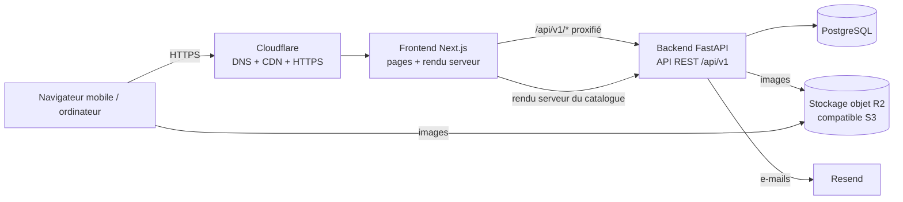
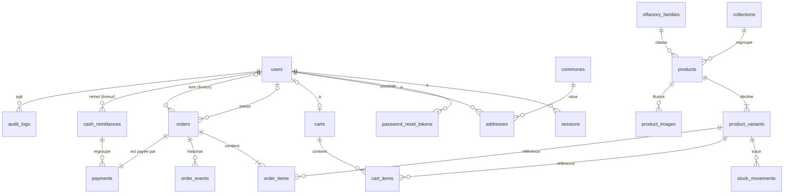

# Conception technique — « Projet Parfums » (MVP)

Version 1 — 2026-10-26 — statut : **validée le 2026-10-26**.

Base : [conception fonctionnelle](02-conception-fonctionnelle.md) validée le 2026-10-26. Les références `F-xx`, `RG-xx`, `US-xx` renvoient à ce document.

---

## 1. Architecture générale



Choix structurants :

1. **Le navigateur ne parle qu'au frontend.** Next.js relaie `/api/v1/*` vers FastAPI (réécriture). Conséquences : une seule origine, cookies `httpOnly` sans configuration CORS, l'URL du backend n'est jamais exposée.
2. **Rendu serveur pour ce qui doit être référencé** (accueil, catalogue, collections, fiches produits, pages de contenu) : les composants serveur Next.js appellent FastAPI directement par l'URL interne, avec un cache de 60 s (revalidation). **Rendu client** (TanStack Query) pour ce qui est personnel : panier, commande, espace client, back-office, espace livreur.
3. **Toutes les règles métier vivent dans FastAPI.** Le frontend affiche et pré-valide ; le serveur décide.
4. **Pas de Redis, pas de file de tâches au MVP.** Limitation de débit stockée dans PostgreSQL, e-mails envoyés après validation de la transaction (tâche d'arrière-plan FastAPI). Volume visé : moins de 50 commandes par jour.

---

## 2. Versions retenues

Vérifiées sur npm et PyPI le 2026-10-26. Les numéros exacts seront figés à l'initialisation (étape 5), en retenant pour chaque paquet une version publiée depuis au moins deux semaines.

| Frontend | Version | | Backend | Version |
|---|---|---|---|---|
| Node.js | 22 LTS | | Python | 3.13 |
| Next.js | 16.4.3 | | FastAPI | 0.143.0 |
| React | 19.3.x | | Pydantic / pydantic-settings | 2.14.x / 2.16.x |
| TypeScript | **6.0.x** (*) | | SQLAlchemy | 2.1.x |
| Tailwind CSS | 4.3.x | | Alembic | 1.20.x |
| shadcn/ui (CLI) | 4.x | | psycopg (pilote PostgreSQL) | 3.3.x |
| TanStack Query | 5.x | | Uvicorn | 0.54.x |
| React Hook Form | 7.x | | pwdlib + argon2 (mots de passe) | 0.3.x |
| Zod | 4.x | | Pillow (contrôle des images) | 13.x |
| Vitest | 5.x | | boto3 (stockage S3/R2) | 1.43.x |
| Playwright | 1.64.x | | httpx (appels HTTP + tests) | 0.28.x |
| pnpm | 11.10 | | pytest | 9.1.x |
| | | | ruff (lint + format), mypy | 0.17.x, 2.4.x |
| | | | uv (gestion Python et dépendances) | dernière stable |
| **PostgreSQL** | **17** | | | |

Versions **effectivement installées à l'étape 5** (2026-10-26) : voir `frontend/package.json`, `backend/pyproject.toml` et les fichiers de verrouillage. Next.js : 16.4.3 au lieu de 16.4.0, car 16.0.0 à 16.4.0 sont touchées par deux failles critiques (exécution de code à distance, avis GHSA-2464-fhr4-w9xw et GHSA-673q-mjm6-r5xr) ; la sécurité prime sur la règle des deux semaines. ESLint reste en 9.39.5 : les plugins de Next.js ne déclarent pas encore la compatibilité avec ESLint 10.

(*) TypeScript 7.0 (nouveau compilateur réécrit en Go, sorti en juillet 2026) est écarté pour l'instant : la compatibilité de tout l'outillage (ESLint, Next.js) n'est pas encore établie. Migration à réévaluer plus tard.

**Zustand** n'est pas prévu : le panier vit côté serveur et passe par TanStack Query. Il sera ajouté seulement si un vrai besoin d'état partagé côté client apparaît.

---

## 3. Structure du dépôt

```
Parfum/
├── SUIVI.md
├── README.md                  # démarrage local
├── docs/                      # conception, décisions, exploitation
├── .github/workflows/         # CI (tests) + sauvegarde quotidienne
├── render.yaml                # description de l'hébergement (étape 9)
├── frontend/
│   ├── package.json
│   ├── next.config.ts         # réécriture /api/v1 → backend, en-têtes de sécurité, images
│   ├── src/
│   │   ├── app/
│   │   │   ├── (boutique)/            # accueil, parfums/, collections/, panier/, commande/, suivi/, pages de contenu
│   │   │   ├── (compte)/compte/       # connexion, inscription, profil, adresses, commandes
│   │   │   ├── admin/                 # back-office
│   │   │   ├── livreur/               # espace livreur
│   │   │   ├── sitemap.ts, robots.ts
│   │   │   └── layout.tsx
│   │   ├── components/
│   │   │   ├── ui/                    # composants shadcn/ui
│   │   │   ├── boutique/ compte/ admin/ livreur/
│   │   ├── lib/
│   │   │   ├── api/                   # client HTTP (CSRF, erreurs typées), requêtes TanStack Query
│   │   │   ├── schemas/               # schémas Zod des formulaires
│   │   │   └── format.ts              # FCFA, dates, téléphone
│   └── tests/                         # Vitest (unitaires) + e2e/ (Playwright)
└── backend/
    ├── pyproject.toml                 # dépendances (uv)
    ├── alembic.ini, alembic/versions/ # migrations versionnées
    ├── app/
    │   ├── main.py                    # application, routeurs, gestion d'erreurs
    │   ├── core/                      # config, base de données, sécurité, erreurs, limitation de débit, audit, e-mails, stockage
    │   └── modules/
    │       ├── auth/                  # inscription, connexion, sessions, mot de passe
    │       ├── customers/             # profil, adresses
    │       ├── catalog/               # collections, familles, produits, variantes, images
    │       ├── inventory/             # mouvements de stock, alertes
    │       ├── cart/
    │       ├── orders/                # commande, statuts, appels, suivi
    │       ├── delivery/              # communes, livreurs, tentatives
    │       ├── payments/              # encaissements, remises de caisse
    │       ├── staff/                 # collaborateurs
    │       ├── dashboard/
    │       ├── contact/
    │       └── settings/
    │       # chaque module : router.py, schemas.py, models.py, service.py
    └── tests/
```

Chaque module sépare **routes** (HTTP), **schémas** (Pydantic, validation), **modèles** (SQLAlchemy) et **service** (règles métier, transactions). Les routes ne contiennent pas de logique métier.

**SQLAlchemy en mode synchrone** (et non asynchrone) : code plus simple à écrire, lire et tester ; FastAPI exécute les routes synchrones dans un pool de threads, ce qui suffit largement au volume visé.

---

## 4. Modèle de données

### 4.1 Diagramme des relations



### 4.2 Tables

Conventions : clés primaires `bigint` auto-incrémentées ; dates en `timestamptz` (UTC en base, affichage heure d'Abidjan = UTC+0) ; **montants en `integer` FCFA**, jamais de décimales ni de flottants ; `created_at` / `updated_at` sur toutes les tables métier.

**Comptes**

| Table | Colonnes principales | Contraintes / index |
|---|---|---|
| `users` | email, password_hash, full_name, phone, **role** (`CUSTOMER`, `COURIER`, `MANAGER`, `OWNER`), is_active, last_login_at, totp_secret (chiffré), totp_recovery_codes (empreintes) | email unique (insensible à la casse), index phone |
| `sessions` | user_id, token_hash, expires_at, last_seen_at, user_agent, ip | token_hash unique ; supprimées à la déconnexion, à l'expiration ou à la désactivation du compte |
| `password_reset_tokens` | user_id, token_hash, expires_at, used_at | token_hash unique ; validité 1 h, usage unique (RG-52) |
| `addresses` | user_id, label, recipient_name, phone, commune_id, address_line, landmark, is_default | une seule adresse par défaut par utilisateur (index unique partiel) |

**Catalogue et stock**

| Table | Colonnes principales | Contraintes / index |
|---|---|---|
| `collections` | name, slug, description, image_key, position, is_active | slug unique |
| `olfactory_families` | name, slug, position | slug unique |
| `products` | name, slug, collection_id, family_id, gender (`FEMME`, `HOMME`, `MIXTE`), description, top_notes, heart_notes, base_notes, **status** (`DRAFT`, `PUBLISHED`, `ARCHIVED`), published_at | slug unique ; index (status, collection_id), (status, family_id) ; recherche insensible aux accents (extension `unaccent`) |
| `product_variants` | product_id, **sku**, volume_ml, price, cost_price (facultatif), **stock_physical**, **stock_reserved**, low_stock_threshold, is_active | sku unique ; `price > 0` ; `stock_reserved >= 0` ; `stock_reserved <= stock_physical` ; unique (product_id, volume_ml) |
| `product_images` | product_id, storage_key, alt_text, position | position 0 = image principale |
| `stock_movements` | variant_id, **type** (`ENTREE`, `AJUSTEMENT`, `RESERVATION`, `LIBERATION`, `SORTIE_VENTE`, `RETOUR`, `PERTE`), delta_physical, delta_reserved, order_id, user_id, reason | index (variant_id, created_at) ; jamais modifiés ni supprimés |

Le stock est porté par la variante (une seule réserve physique) : pas de table `inventory` séparée. Le disponible (RG-10) = `stock_physical − stock_reserved`, calculé. Les contraintes `CHECK` sont le dernier rempart : même une erreur de code ne peut pas produire un stock négatif ou une réservation supérieure au physique.

**Panier**

| Table | Colonnes principales | Contraintes |
|---|---|---|
| `carts` | token_hash (visiteur), user_id (client), updated_at | token_hash unique, user_id unique |
| `cart_items` | cart_id, variant_id, quantity | unique (cart_id, variant_id) ; `quantity BETWEEN 1 AND 5` (RG-22) |

**Commandes, livraison, encaissement**

| Table | Colonnes principales | Contraintes / index |
|---|---|---|
| `orders` | **number** (`PP-10001`…), user_id (vide si invité), **status**, idempotency_key, **copie figée** : customer_name, phone, email, commune_name, address_line, landmark, delivery_fee, delivery_delay_label ; subtotal, total, courier_id, delivery_attempts, cancel_reason | number unique ; idempotency_key unique ; index (status, created_at), phone, user_id, courier_id ; `total = subtotal + delivery_fee` |
| `order_items` | order_id, variant_id, **copie figée** : product_name, volume_ml, sku, unit_price ; quantity, line_total | `line_total = unit_price × quantity` ; la variante ne peut pas être supprimée si elle est référencée |
| `order_events` | order_id, **kind** (`STATUS_CHANGE`, `CALL`, `DELIVERY_ATTEMPT`, `NOTE`), from_status, to_status, call_result, failure_reason, note, user_id | index (order_id, created_at) ; historique en ajout seul |
| `communes` | name, delivery_fee, delay_label, is_active, position | name unique ; `delivery_fee >= 0` |
| `payments` | order_id, **method** (`CASH_ON_DELIVERY` ; d'autres moyens plus tard), **status** (`A_ENCAISSER`, `ENCAISSE`, `REMIS`, `ANNULE`, `REMBOURSE`), amount, collected_by, collected_at, remittance_id, refunded_at | order_id unique (un paiement par commande au MVP) |
| `cash_remittances` | courier_id, received_by, expected_amount, received_amount, difference, note | lecture seule après création (RG-45) |

L'adresse et les articles sont **recopiés** dans la commande (RG-26) : modifier un produit, un prix, une commune ou une adresse ne change jamais une commande passée. Les livraisons ne forment pas une table à part : une commande = une livraison au MVP, les tentatives sont des `order_events`.

**Transverses**

| Table | Rôle |
|---|---|
| `audit_logs` | user_id, action, entity_type, entity_id, before, after (JSON), ip — actions sensibles du back-office (RG-53), en ajout seul |
| `contact_messages` | name, phone, email, message, status (`NOUVEAU`, `TRAITE`) |
| `settings` | clé / valeur JSON : informations de la boutique (nom, téléphone, WhatsApp, adresse) |
| `rate_limit_hits` | clé, fenêtre, compteur — limitation de débit sans Redis |

### 4.3 Tables de la liste initiale non créées au MVP

| Table proposée | Décision | Raison |
|---|---|---|
| `brands` | non créée | marque unique ; remplacée par `collections` |
| `roles`, `permissions` | non créées | 4 rôles fixes : une colonne `role` + une table de droits dans le code suffisent ; tables à ajouter avec les permissions granulaires |
| `inventory` | fusionnée | stock porté par `product_variants` |
| `shipments` | fusionnée | une livraison par commande ; tentatives dans `order_events` |
| `promotions`, `promotion_usages`, `reviews`, `wishlists` | reportées | hors MVP |
| `notifications` | reportée | e-mails non persistés au MVP ; l'historique de la commande fait foi |

---

## 5. Gestion du stock (garantie anti-survente)

Toutes les opérations de stock passent par **une seule fonction de service** qui, dans la même transaction, met à jour la variante **et** écrit le mouvement (RG-11).

**Réservation à la commande (RG-12, US-06)** — dans une seule transaction :
1. Les lignes sont traitées **triées par identifiant de variante** (ordre constant pour éviter les interblocages entre deux commandes).
2. Pour chaque ligne, mise à jour conditionnelle :
   `UPDATE product_variants SET stock_reserved = stock_reserved + :q WHERE id = :id AND is_active AND stock_physical - stock_reserved >= :q`
   Si aucune ligne n'est modifiée, le stock manque : la transaction est **entièrement annulée** et le client reçoit la liste des articles concernés (code `INSUFFICIENT_STOCK`).
3. Création de la commande, des lignes, du paiement `A_ENCAISSER`, des mouvements `RESERVATION`, de l'événement initial.

Cette mise à jour conditionnelle est atomique dans PostgreSQL : deux commandes simultanées sur la dernière unité ne peuvent pas réussir toutes les deux. Un **test automatisé** le vérifiera avec des requêtes réellement concurrentes sur une vraie base PostgreSQL.

**Autres transitions** (mêmes garanties) :
- Annulation avant livraison → `LIBERATION` (réservé −q).
- Passage « En livraison » → `SORTIE_VENTE` (physique −q, réservé −q).
- Colis revenu et contrôlé → `RETOUR` (physique +q) ou `PERTE` (aucun retour en stock, trace seule).
- Ajustement manuel → `AJUSTEMENT` avec motif ; refusé s'il ferait passer le physique sous le réservé (il faut d'abord annuler des commandes).

**Changements de statut de commande** : la commande est verrouillée (`SELECT … FOR UPDATE`), la transition est vérifiée contre la table des transitions autorisées (§6.1 de la conception fonctionnelle) et le rôle de l'auteur, puis statut, stock, paiement, événement et audit sont écrits dans la même transaction.

---

## 6. Authentification et sécurité

**Sessions côté serveur** (et non JWT) : à la connexion, un jeton aléatoire de 32 octets est placé dans un cookie ; la base n'en garde que l'empreinte SHA-256. Avantage décisif : désactiver un collaborateur ou se déconnecter **coupe l'accès immédiatement** (RG-54), ce qu'un JWT ne permet pas.

| Élément | Choix |
|---|---|
| Cookie de session | `httpOnly`, `Secure` (production), `SameSite=Lax`, chemin `/` |
| Durée | clients : 30 jours glissants ; collaborateurs : 12 h |
| Mots de passe | Argon2id (pwdlib) ; 10 caractères minimum (RG-50) |
| CSRF | cookie `csrf` lisible + en-tête `X-CSRF-Token` identique exigé sur toute requête qui modifie quelque chose ; vérification de l'en-tête `Origin` |
| Limitation de débit | connexion (par e-mail et par IP), mot de passe oublié, création de commande, suivi invité, formulaire de contact — compteurs en base |
| Énumération | mot de passe oublié et suivi invité renvoient une réponse identique, que la donnée existe ou non |
| Permissions | dépendance FastAPI `require_role(...)` sur chaque route ; le livreur est en plus filtré sur ses propres commandes (RG-42) |
| Validation | Pydantic sur toutes les entrées ; SQLAlchemy avec requêtes paramétrées (pas d'injection SQL) |
| Erreurs | format unique `{"error": {"code": "…", "message": "…", "details": …}}` ; aucune trace technique renvoyée au client |
| Images envoyées | contrôle du contenu réel par Pillow (pas seulement l'extension), ré-encodage en WebP (≤ 2000 px), ce qui supprime aussi les métadonnées ; 5 Mo maximum |
| En-têtes | HTTPS forcé (HSTS), `Content-Security-Policy`, `X-Frame-Options`, `Referrer-Policy` via Next.js |
| Secrets | uniquement en variables d'environnement ; `.env` ignoré par Git |

**Protection renforcée des comptes administrateurs** : sessions courtes, limitation de débit stricte, journal d'audit. **Double authentification par application (TOTP)** obligatoire pour les rôles Propriétaire et Gestionnaire (dépendance `pyotp`), avec codes de secours à usage unique. Décidée le 2026-10-26.

**Double clic et réseau instable** : le frontend envoie une clé d'idempotence (identifiant unique généré à l'ouverture de la page de commande). Un second envoi avec la même clé renvoie la commande déjà créée au lieu d'en créer une deuxième.

**Prix changés** : la création de commande inclut le total attendu par le client ; s'il diffère du calcul serveur, réponse `PRICE_CHANGED` avec le nouveau récapitulatif (RG-21).

---

## 7. API REST `/api/v1`

Documentation OpenAPI générée automatiquement (`/api/v1/docs`, désactivée en production ou réservée aux administrateurs). Codes HTTP : 200/201 succès, 400/422 validation, 401 non connecté, 403 interdit, 404 introuvable, 409 conflit métier (stock, prix, transition), 429 trop de requêtes.

**Public et client**

| Méthode | Route | Rôle |
|---|---|---|
| GET | `/health` | état du service et de la base |
| POST | `/auth/register`, `/auth/login`, `/auth/logout` | comptes |
| POST | `/auth/forgot-password`, `/auth/reset-password` | mot de passe |
| GET | `/auth/me` | utilisateur connecté |
| GET | `/catalog/collections`, `/catalog/families` | navigation |
| GET | `/catalog/products?q=&collection=&family=&gender=&min_price=&max_price=&volume=&in_stock=&sort=&page=` | catalogue, recherche, filtres, tri |
| GET | `/catalog/products/{slug}` | fiche produit (+ similaires) |
| GET | `/catalog/home` | blocs de l'accueil |
| GET | `/delivery/communes` | communes desservies, frais, délais |
| GET / POST / PATCH / DELETE | `/cart`, `/cart/items`, `/cart/items/{variant_id}` | panier |
| POST | `/checkout/preview` | récapitulatif calculé par le serveur |
| POST | `/orders` | création (invité ou client) |
| POST | `/orders/track` | suivi invité (numéro + téléphone) |
| GET | `/me/orders`, `/me/orders/{number}` | commandes du client |
| POST | `/me/orders/{number}/cancel` | annulation (RG-32) |
| GET / PATCH | `/me/profile` ; POST `/me/password` | profil |
| GET / POST / PATCH / DELETE | `/me/addresses[/{id}]` | adresses |
| POST | `/contact` | message de contact |

**Back-office** (`/admin/*`, rôles Gestionnaire ou Propriétaire sauf mention)

| Méthode | Route | Rôle |
|---|---|---|
| GET | `/admin/dashboard?from=&to=` | indicateurs |
| CRUD | `/admin/collections`, `/admin/families`, `/admin/products`, `/admin/products/{id}/variants` | catalogue |
| POST / PATCH / DELETE | `/admin/products/{id}/images` | images |
| POST | `/admin/products/{id}/publish`, `/unpublish`, `/archive` | publication |
| GET / POST | `/admin/stock`, `/admin/stock/movements`, `/admin/variants/{id}/movements` | stock |
| GET | `/admin/orders?status=&from=&to=&commune=&courier=&q=` | liste et recherche |
| GET | `/admin/orders/{number}` | détail + historique |
| POST | `/admin/orders/{number}/calls` | appel de confirmation |
| POST | `/admin/orders/{number}/transition` | changement de statut (avec livreur, motif) |
| POST | `/admin/orders/{number}/return` | retour d'une commande livrée (Propriétaire) |
| GET | `/admin/orders/{number}/print/{picking\|delivery}` | bon de préparation / bordereau (HTML imprimable) |
| GET / POST | `/admin/remittances`, `/admin/couriers/{id}/pending-cash` | encaissements |
| GET | `/admin/customers`, `/admin/customers/{id}` | clients |
| GET / PATCH | `/admin/contact-messages[/{id}]` | messages |
| CRUD | `/admin/communes`, `/admin/settings` | paramètres (Propriétaire) |
| CRUD | `/admin/staff` | collaborateurs (Propriétaire) |
| GET | `/admin/audit-logs` | journal (Propriétaire) |

**Livreur** : GET `/courier/deliveries` ; POST `/courier/deliveries/{number}/delivered`, `/courier/deliveries/{number}/failed`.

**Webhooks** : aucun au MVP (pas de prestataire de paiement). Le module `payments` est prévu pour accueillir un prestataire mobile money : route `/webhooks/{prestataire}` avec vérification de signature et idempotence, ajoutée le moment venu.

---

## 7 bis. Frontend : rendu, référencement, performances

- **Pages référencées** rendues côté serveur avec métadonnées (`generateMetadata`), URL lisibles (`/parfums/<slug>`, `/collections/<slug>`), données structurées `Product` (JSON-LD), `sitemap.xml` et `robots.txt` générés depuis l'API.
- **Images** via `next/image` (formats modernes, tailles adaptées à l'écran, chargement différé).
- **Polices** auto-hébergées via `next/font` (pas d'appel externe bloquant).
- **Formulaires** React Hook Form + Zod ; les mêmes règles sont revérifiées par le serveur.
- **Mesure** : Lighthouse mobile sur l'accueil, le catalogue et une fiche produit à chaque jalon frontend ; objectif LCP < 2,5 s.

---

## 8. E-mails, journaux, observabilité

- **E-mails** : Resend, via son API HTTP (pas de SDK supplémentaire). En développement, les e-mails sont affichés dans la console. Envoi après validation de la transaction ; un échec d'envoi est journalisé sans bloquer la commande.
  *shortcut : pas de file de réessai ; à ajouter (table d'envoi + tâche planifiée) si des pertes d'e-mails sont constatées.*
- **Journaux** : sortie texte standard d'uvicorn et des modules (format JSON et identifiant par requête non réalisés au MVP) ; aucun mot de passe ni jeton journalisé.
- **Erreurs** : prévu avec Sentry ; **non intégré au MVP** (étape 9) : journaux et notifications Render. À ajouter si les erreurs passent inaperçues.
- **Santé** : `/api/v1/health` vérifie la connexion à la base ; utilisé par l'hébergeur pour redémarrer un service défaillant.

---

## 9. Hébergement et déploiement

**Recommandation : Render (région Francfort) + Cloudflare + R2.**

| Service | Rôle | Coût estimé / mois |
|---|---|---|
| Render — service web « Starter » | frontend Next.js | ~7 $ |
| Render — service web « Starter » | backend FastAPI | ~7 $ |
| Render — PostgreSQL « Basic 256 Mo » | base de données | ~6 $ |
| Cloudflare | DNS, HTTPS, cache, protection | 0 $ (offre gratuite) |
| Cloudflare R2 | images + sauvegardes | 0 $ jusqu'à 10 Go, sans frais de sortie |
| Resend | e-mails transactionnels | 0 $ (offre gratuite, à vérifier selon volume) |
| Sentry | suivi des erreurs | 0 $ (offre gratuite) |
| Nom de domaine | `.ci` ou `.com` | ~10–40 $ / an selon l'extension |
| **Total production** | | **≈ 20 $ / mois (≈ 12 000 FCFA)** + domaine |

Ces prix proviennent de sources tierces récentes ; ils seront revérifiés sur les pages officielles avant l'ouverture des comptes (étape 9). Premier palier de croissance probable : le frontend à 512 Mo de mémoire pourrait devoir passer au palier supérieur (~25 $).

**Alternatives écartées** :
- *Vercel (frontend) + Render (backend)* : l'offre gratuite de Vercel interdit l'usage commercial ; l'offre Pro (20 $ par membre) porte le total vers 33 $ et ajoute une plateforme.
- *Serveur privé virtuel (VPS)* : moins cher (~5 €), mais mises à jour système, sécurité et sauvegardes à gérer soi-même : risqué pour un propriétaire non technicien.

**Déploiement** :
- Chaque envoi sur `main` déclenche la CI (GitHub Actions : lint, typage, tests backend sur PostgreSQL réel, tests frontend, build). Render ne déploie que si la CI est verte.
- Migrations Alembic appliquées automatiquement avant le démarrage de la nouvelle version (commande de pré-déploiement).
- Retour arrière : redéploiement de la version précédente en un clic sur Render ; les migrations sont écrites pour rester compatibles avec la version précédente du code.
- Environnement de préproduction : mêmes services en taille minimale, à chiffrer à l'étape 9.

**Sauvegardes** : sauvegardes automatiques de Render (rétention à vérifier pour l'offre Basic) **et**, indépendamment, un export quotidien `pg_dump` par GitHub Actions vers un compartiment R2 privé, conservé 30 jours. Procédure de restauration écrite et testée (restauration dans une base temporaire) avant la mise en production.

---

## 10. Environnement local de développement

Constat sur ta machine (macOS 13) : Node 22 et pnpm 9 présents ; **Python 3.9 seulement** (FastAPI exige 3.10 minimum) ; **ni Docker ni PostgreSQL**.

Retenu à l'étape 5 :
- **uv** (installé via pip, paquet précompilé) installe Python 3.13 et les dépendances du backend, sans toucher au Python du système.
- **PostgreSQL 17 via Postgres.app** : sur macOS 13, Homebrew n'a plus de paquets précompilés et compile depuis les sources (Rust, OpenSSL, ICU…), ce qui prend des heures. Postgres.app est signé et notarisé par Apple.
- Un `docker-compose.yml` est fourni pour ceux qui préfèrent Docker.
- **Playwright ne fournit pas Chromium pour macOS 13** : les tests de parcours navigateur s'exécutent dans la CI (Linux).

Commandes prévues (détaillées dans le README à l'étape 5) : `pnpm dev` (frontend), `uv run fastapi dev` (backend), `uv run alembic upgrade head` (migrations), `uv run pytest`, `pnpm test`, `pnpm test:e2e`.

---

## 11. Stratégie de tests

| Niveau | Outil | Contenu |
|---|---|---|
| Backend — unitaires et API | pytest + httpx | règles métier (transitions, totaux, permissions par rôle, validations), chaque route ; **base PostgreSQL réelle** (pas SQLite), réinitialisée à chaque test |
| Backend — concurrence | pytest + threads | dernière unité commandée simultanément : une seule commande réussit (US-06) ; double envoi avec la même clé d'idempotence |
| Frontend — unitaires | Vitest | formatage FCFA, schémas Zod, client API (CSRF, erreurs), composants clés |
| Bout en bout | Playwright (mobile + ordinateur) | P1 achat invité, P4 traitement d'une commande, P5 clôture livreur, connexion, droits refusés |
| Qualité | ruff, mypy, ESLint, `tsc` | à chaque envoi (CI) |
| Performance | Lighthouse | jalons frontend |

---

## 12. Variables d'environnement

Liste exhaustive (mise à jour à l'étape 10). En production, les valeurs sont saisies dans Render : voir `render.yaml` et `docs/09-deploiement.md`.

**Backend** (`backend/.env.example`)

| Variable | Obligatoire | Rôle |
|---|---|---|
| `DATABASE_URL` | oui | `postgresql+psycopg://…` (`postgresql://…` accepté, converti) |
| `SECRET_KEY` | oui | chiffre les secrets de double authentification ; ≥ 32 caractères en production ; ne pas changer sans raison (docs/09 §5) |
| `APP_ENV` | non | `development` (défaut) / `test` / `production` (active les garde-fous de démarrage) |
| `FRONTEND_ORIGIN` | production | `https://<domaine>` : vérification de l'en-tête `Origin` |
| `COOKIE_SECURE` | production | `true` : cookies envoyés en HTTPS uniquement |
| `TRUSTED_PROXY_HOPS` | production | relais ajoutant une adresse à `X-Forwarded-For` : 1 (Render), 2 (Cloudflare + Render) |
| `S3_ENDPOINT_URL`, `S3_BUCKET`, `S3_ACCESS_KEY_ID`, `S3_SECRET_ACCESS_KEY`, `S3_PUBLIC_BASE_URL` | production | images sur Cloudflare R2 ; vides → disque local `media/` |
| `MEDIA_DIR`, `MEDIA_BASE_URL` | non | stockage local (défaut `media`, `/media`) |
| `RESEND_API_KEY`, `EMAIL_FROM` | recommandé | e-mails ; sans clé : console (dév.) ou erreur journalisée (prod.) |
| `SHOP_NOTIFICATION_EMAIL` | recommandé | destinataire des alertes (nouvelles commandes, stock bas) |
| `ORDER_NUMBER_PREFIX` | non | préfixe des numéros de commande (défaut `PP`) |
| `PAYMENT_PROVIDER`, `PAYMENT_WEBHOOK_SECRET` | non | mobile money : vide = désactivé, `simulation` = faux paiements (refusé en production) ; prestataire réel à brancher |
| `TEST_DATABASE_URL` | tests | base dédiée aux tests pytest |
| `SEED_STAFF_PASSWORD`, `SEED_MANAGER_TOTP_SECRET` | CI | comptes de test E2E créés par `seed_demo` (jamais en production) |

**Frontend** (`frontend/.env.example`)

| Variable | Rôle |
|---|---|
| `BACKEND_INTERNAL_URL` | URL du backend pour le relais `/api/v1` et le rendu serveur, jamais exposée au navigateur ; « hôte:port » accepté. **Lue au build.** |
| `NEXT_PUBLIC_SITE_URL` | URL publique (sitemap, robots). **Lue au build.** |

**GitHub Actions** (secrets, sauvegarde) : `BACKUP_DATABASE_URL`, `R2_ENDPOINT`, `R2_BACKUP_BUCKET`, `R2_BACKUP_ACCESS_KEY_ID`, `R2_BACKUP_SECRET_ACCESS_KEY`.

Non retenus au MVP : Sentry (`SENTRY_DSN`), domaine d'images côté frontend (les URL d'images viennent de l'API).

---

## 13. Décisions du porteur du projet (2026-10-26)

1. **Hébergement** : Render (Francfort) + Cloudflare + R2, ≈ 20 $ / mois — validé.
2. **Double authentification (TOTP)** pour Propriétaire et Gestionnaire au MVP — validée.
3. **Environnement local** : PostgreSQL via Homebrew + Python via uv (Docker facultatif) — validé.
